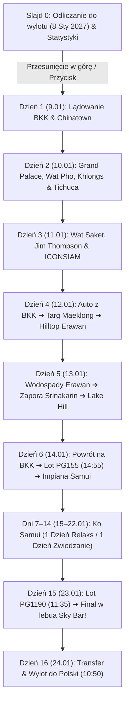

# 📱 Aplikacja Mobilna PWA: Tajlandia 2027
**Architektura, Funkcje i Przewodnik Uruchomienia na iPhone**

---

## 🚀 Przegląd Aplikacji

Aplikacja **Tajlandia 2027** została zaprojektowana jako nowoczesna **Progresywna Aplikacja Internetowa (PWA)** zoptymalizowana w 100% pod system **iOS (iPhone)** i przeglądarkę Safari. Działa płynnie na pełnym ekranie (*standalone*), integrując się z paskiem statusu i Dynamic Island / notchem, a po dodaniu do ekranu początkowego zachowuje się jak natywna aplikacja z App Store i działa **w trybie offline**.

```
Katalog projektu:
C:\Users\mosan\.gemini\antigravity\scratch\thailand-trip-app\
├── index.html          # Pełna aplikacja SPA/PWA ze stylami, danymi i logiką
├── manifest.json       # Konfiguracja PWA dla iOS i Androida
├── sw.js               # Service Worker do obsługi pamięci podręcznej i trybu offline
├── icon-192.png        # Ikona aplikacji dla urządzeń mobilnych
├── icon-512.png        # Ikona wysokiej rozdzielczości
└── build_app.py        # Generator / silnik aktualizacji treści harmonogramu
```

---

## 🎨 Kluczowe Funkcje UX i Interakcji



1. **Płynny przewijak wertykalny (*Full-Page Snap*):**
   - Naturalne, gestowe przesuwanie stron z dołu do góry (`scroll-snap-type: y mandatory`), wzorowane na płynności rolek Instagrama / TikToka.
   - Płynne przewijanie do dowolnego slajdu przyciskami nawigacyjnymi.
2. **Dynamiczny licznik na żywo (*Live Countdown*):**
   - Na pierwszej stronie zegar odlicza w czasie rzeczywistym dni, godziny, minuty i sekundy do wylotu (8 stycznia 2027).
3. **Karty dni z pełną wiedzą:**
   - Wysokiej jakości tła fotograficzne dopasowane do motywu każdego dnia z filtrami gradientowymi ułatwiającymi czytanie tekstu.
   - Karta bazy noclegowej (Mövenpick, Hilltop Erawan, Lake Hill, Impiana Chaweng Noi, lebua at State Tower).
   - Oś czasu z godzinami, tytułami i opisami.
   - **Etykiety cenowe** (np. `500 THB`, `Wstęp bezpłatny`, `300 THB + 30 THB auto (GOTÓWKA)`).
   - **Porady / wskazówki ekspertów** (np. o dress codzie, porannych godzinach wejścia, butach).
   - **Interaktywny przycisk Google Maps** dla każdej atrakcji – jedno dotknięcie otwiera aplikację Mapy Google w telefonie z gotową trasą!
4. **Szybki Spis Dni (Drawer):**
   - Kliknięcie ikony 📅 na górnym pasku wysuwa dolny arkusz z pełną listą 16 dni – pozwala przeskoczyć do dowolnego punktu podróży w ułamku sekundy.
5. **Obsługa Offline (*Service Worker*):**
   - Wszystkie kluczowe dane tekstowe, style i ikony są zapisywane w pamięci podręcznej telefonu – przewodnik działa nawet w trybie samolotowym lub w sercu dżungli bez zasięgu.

---

## 📲 Jak wpiąć aplikację do ekranu głównego iPhone'a?

Aby aplikacja działała jak natywna appka (bez pasków przeglądarki Safari i na pełnym ekranie):

1. **Otwórz stronę w przeglądarce Safari** na iPhone (np. poprzez link z hostingu).
2. Na dolnym pasku Safari dotknij ikony **Udostępnij** (niebieski kwadrat ze strzałką w górę: `⬆️`).
3. Przewiń listę opcji w dół i wybierz **„Do ekranu początkowego”** (*Add to Home Screen*).
4. Potwierdź klikając **„Dodaj”** w prawym górnym rogu.
5. Na pulpicie Twojego iPhone'a pojawi się złoto-turkusowa ikona ze świątynią o nazwie **„Tajlandia”**. Po jej dotknięciu aplikacja otworzy się na pełnym ekranie!

---

## 🌐 Opcje Uruchomienia / Wdrożenia

### Opcja A: Błyskawiczny darmowy hosting (zalecana, by mieć link na telefon)
Możesz opublikować ten folder jednym kliknięciem:
* **Vercel / Netlify:** przeciągnij folder `thailand-trip-app` na stronę [drop.netlify.com](https://app.netlify.com/drop) lub połącz z GitHubem – otrzymujesz darmowy link `https://twoj-projekt.netlify.app`.
* **GitHub Pages:** utwórz małe repozytorium i włącz GitHub Pages w ustawieniach.

### Opcja B: Podgląd lokalny w sieci Wi-Fi
Możesz uruchomić serwer w terminalu:
```bash
python -m http.server 8080 --directory C:\Users\mosan\.gemini\antigravity\scratch\thailand-trip-app
```
I otworzyć w Safari na iPhone adres: `http://<IP-TWOJEGO-KOMPUTERA>:8080`.
